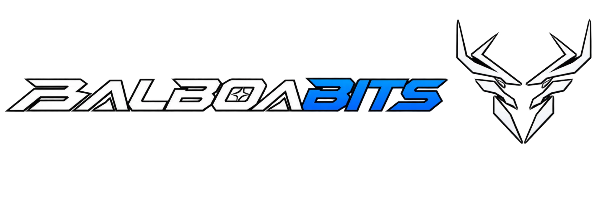

<div align="center">
  
  <h1>¡Bienvenidos a BALBOABITS!</h1>
  <p><strong>Una experiencia de tecnología, creada con talento y corazón panameño.</strong></p>
  <p>Un proyecto académico colaborativo para imaginar cómo se siente comprar tecnología en línea.</p>
  <p>
    
    
    
  </p>
</div>

---

## Nuestra idea

BALBOABITS nace como una propuesta para acercar la tecnología a las personas mediante una tienda digital clara, atractiva y fácil de recorrer. Reunimos catálogo, ofertas y una experiencia de compra de demostración en un solo sitio, cuidando tanto el diseño como la navegación.

Este proyecto fue realizado por sus colaboradores como parte de un proceso de aprendizaje. Combina desarrollo web, identidad visual y trabajo en equipo; no es una tienda en producción ni procesa compras reales.

> Gracias por pasar por aquí. Esperamos que disfrutes explorando BALBOABITS tanto como nosotros disfrutamos creándolo.

## Explora el proyecto

| Sección | Qué encontrarás |
| --- | --- |
| [Inicio](index.html) | La presentación de la marca y una selección destacada de productos. |
| [Catálogo](catalogo.html) | Búsqueda, filtros, categorías y navegación por productos. |
| [Ofertas](ofertas.html) | Una selección promocional de demostración. |
| [Gadgets](gadgets.html) | Accesorios, memorias y unidades de almacenamiento. |
| [Empresas](empresas.html) | Información y opciones pensadas para clientes empresariales. |
| [Colaboradores](colaboradores.html) | Las personas y aportes detrás del proyecto. |

## Un proyecto hecho en equipo

Cada colaborador aportó una parte distinta para convertir la idea en una experiencia coherente:

- **Adrián Cisneros** — Diseño de interfaz, desarrollo web, identidad visual y construcción de las principales secciones y funciones del sitio.
- **Tomas Juárez** — Redacción y revisión de contenido, elección del animal representativo y pruebas visuales y de navegación.
- **Carlos Castillo** — Propuesta del nombre, organización del documento, validación de enlaces y revisión de información.

**Contexto académico:** Universidad de Panamá · Extensión Universitaria de Aguadulce · Facultad de Informática, Electrónica y Comunicación · Licenciatura en Comercio Electrónico.

## Tecnologías

Hecho con **HTML, CSS y JavaScript**, sin frameworks ni pasos de compilación. El sitio usa diseño responsive, animaciones CSS, carga diferida de imágenes y respeta la preferencia del dispositivo por reducir el movimiento.

## Cómo verlo en tu computadora

1. Descarga o clona este repositorio y abre en Visual Studio Code la carpeta del proyecto, donde están este `README.md` e `index.html`.
2. Inicia un servidor local, por ejemplo con la extensión **Live Server** o ejecutando:

   ```bash
   python -m http.server 8000
   ```

3. Visita [http://localhost:8000](http://localhost:8000).

No necesitas instalar dependencias ni compilar el proyecto.

## Estructura

- `index.html`: portada y presentación de la marca.
- `catalogo.html`, `gadgets.html`, `ofertas.html`: catálogo, selección de gadgets y ofertas.
- `producto.html`: ficha dinámica de producto, seleccionada mediante `?id=`.
- `carrito.html`: carrito persistente en el navegador.
- `empresas.html`, `contacto.html`, `colaboradores.html`, `agradecimiento.html`: información del proyecto y sus colaboradores.
- `login.html`, `registro.html`: formularios de demostración.
- `cookies.html`: aviso sobre privacidad y almacenamiento del navegador.
- `404.html`: página personalizada para direcciones no encontradas.
- `css/styles.css`: estilos y sistema visual responsive.
- `js/app.js`: catálogo de ejemplo, navegación, búsqueda, filtros, carrito y animaciones.
- `images/brand/`: logotipos, emblemas e identidad institucional.
- `images/people/`: retratos y avatares de colaboradores.
- `images/products/`: imágenes de productos.
- `images/payments/`: logotipos de Yappy, Banco General y Clave.
- `images/misc/`: imágenes de uso general.

### Subir las imágenes a GitHub

GitHub limita cada carga desde la página web a menos de 100 archivos. No selecciones toda la carpeta `images` de una sola vez: súbela por estas tandas, conservando las mismas rutas:

- `images/brand/` (8 archivos)
- `images/misc/` (2 archivos)
- `images/payments/` (3 archivos)
- `images/people/` (7 archivos)
- Archivos directamente dentro de `images/products/` (63 archivos)
- `images/products/optimized/` (60 archivos)

En particular, no cargues `images/products/` completa como una sola tanda: contiene 123 archivos al contar `optimized/`. Si también estás subiendo el resto del proyecto desde la web de GitHub, divídelo en tandas de menos de 100 archivos. GitHub Desktop o Git desde la terminal evitan ese límite de carga por navegador.

## Catálogo de demostración

Los **60 productos** de ejemplo están centralizados en el arreglo `P`, al inicio de `js/app.js`. Incluyen categorías de audio, hogar, computadoras, gaming, móviles y gadgets. El catálogo muestra 10 productos por página y aplica búsqueda, filtros y orden antes de paginar.

Cada producto contiene un identificador (`id`), nombre (`n`), categoría (`c`), precio actual (`p`), precio anterior opcional (`o`) y lista de características (`s`). Las ofertas se seleccionan en `SALE_PRODUCT_IDS`. Los productos, precios, imágenes, promociones y opiniones son contenido de muestra: reemplázalos por información verificada antes de presentar una tienda real.

## Alcance de la demostración

Para que el propósito del proyecto sea transparente:

- El carrito se guarda en el `localStorage` del navegador.
- El inicio de sesión, el registro y los formularios solo se validan en el navegador: no crean cuentas ni envían datos a un servidor.
- El botón de compra no procesa pagos; Yappy, Banco General y Clave aparecen como referencias visuales.
- No hay backend, API de inventario, base de datos ni panel administrativo.
- El reloj de ofertas muestra la hora local de Panamá; no sincroniza precios ni inventario.
- No se usan cookies propias de analítica o publicidad. Algunas preferencias usan almacenamiento del navegador y las tipografías se cargan desde Google Fonts.

Para convertir el prototipo en una tienda real, harían falta servicios de servidor, autenticación segura, persistencia de datos, gestión de inventario y una pasarela de pago. **No guardes contraseñas ni información sensible en el navegador.**

## Identidad y detalles

- La entrada presenta el logotipo de BALBOABITS y el emblema del venado.
- Los logotipos oficiales se encuentran en `images/brand/`; el favicon usa `deer-favicon.png`.
- Space Grotesk se usa en titulares y marca; Manrope, en textos e interfaz.
- El diseño contempla móviles, tabletas y escritorio, además de la preferencia `prefers-reduced-motion`.
- La pantalla de entrada puede mostrarse de nuevo al regresar al sitio; no se repite al navegar entre sus páginas.

---

<div align="center">
  <strong>BALBOABITS</strong><br>
  Hecho con colaboración, curiosidad y espíritu panameño. 🇵🇦
</div>
